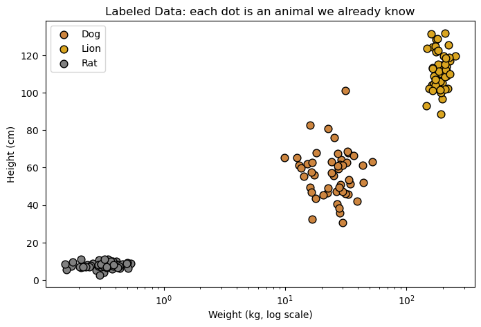
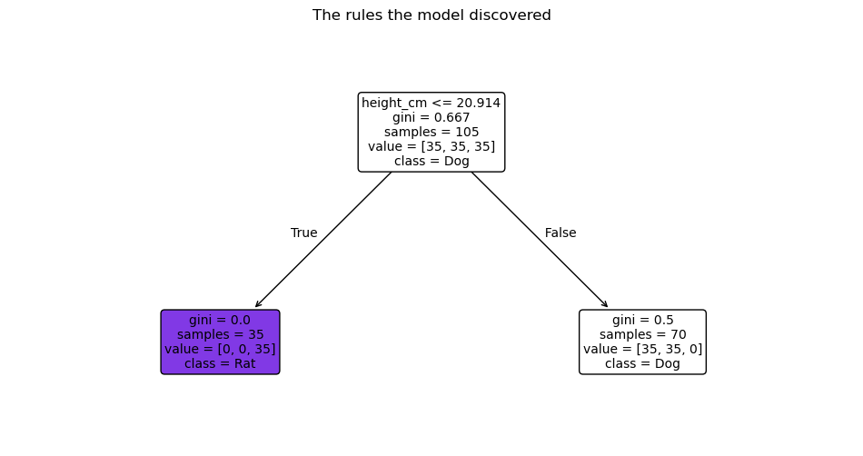
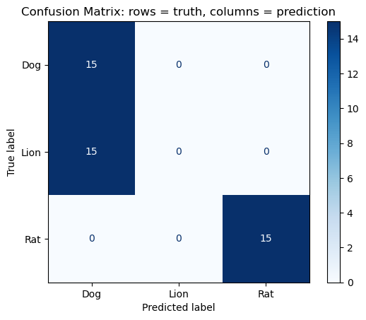

# Lab 1 Setup Guide: Organizing a Supervised Learning Project on NRP JupyterHub

**Course:** CAP 4620 Artificial Intelligence, Florida A&M University
**Lab:** Lab 1, Supervised Learning (Rat, Dog, or Lion?)
**Notebook:** `SupervisedL (1).ipynb`

---

## What you will build

By the end of this lab, your project folder on the NRP JupyterHub will look like a real, shareable machine learning project:

```
Lab1_SupervisedL/
├── data/                  # CSV files created by the notebook
├── figures/               # PNG images of every plot
├── models/                # the trained model saved to disk
├── README.md              # a description of your project
└── SupervisedL.ipynb      # the notebook
```

The steps are:

1. Log in to the NRP JupyterHub
2. Create the project folder
3. Upload the notebook into the folder
4. Create `data/`, `figures/` and `models/` with the terminal
5. Run the notebook and fill `data/` and `models/`
6. Export the figures (LaTeX export) and put the PNGs in `figures/`
7. Write the `README.md`
8. Submit your project to GitHub for grading
9. Final checklist

---

## Part 1: Log in to the NRP JupyterHub

1. Open the NRP JupyterHub link posted on Canvas (for example `https://jupyterhub-west.nrp-nautilus.io`).
2. Click **Sign in** and choose **Florida A&M University** as your identity provider (CILogon). Log in with your FAMU credentials.
3. Pick the server/image your instructor tells you to use and click **Start**. The first start can take a minute or two.
4. When JupyterLab opens you will see three main areas:
   - **Left:** the File Browser (your files and folders)
   - **Center:** the notebook or file you have open
   - **Top:** the menu bar (`File`, `Edit`, `View`, `Run`, `Kernel`, ...)

> 💡 Your files on the NRP hub are saved in your home folder (`/home/jovyan`). They stay there when you log out, but always keep a copy of important work (download it or push it to GitHub, see Part 9).

---

## Part 2: Create the project folder (using the File Browser)

1. In the left File Browser, make sure you are in your home folder. The path bar should show `/`. If not, click the folder icon next to the path to go back to home.
2. Click the **New Folder** button (the folder icon with a `+`, next to the blue `+` Launcher button). You can also right-click an empty area and choose **New Folder**.
3. A folder named `Untitled Folder` appears. Type the new name: `Lab1_SupervisedL` and press **Enter**.
   - If you clicked away before renaming, right-click the folder → **Rename**.
4. Double-click `Lab1_SupervisedL` to open it. The path bar should now read `/ Lab1_SupervisedL /`.

> ⚠️ **Naming rule:** avoid spaces and special characters in folder and file names. Use `Lab1_SupervisedL`, not `Lab 1 Supervised L`. Spaces make terminal commands harder (see Part 4).

---

## Part 3: Bring the Jupyter notebook into NRP

First download `SupervisedL (1).ipynb` from Canvas to your computer. Then use **one** of these options.

### Option A: Upload button
1. Make sure you are **inside** `Lab1_SupervisedL` (check the path bar).
2. Click the **Upload** button (the up arrow ⬆ in the File Browser toolbar).
3. Select `SupervisedL (1).ipynb` on your computer and click **Open**.

### Option B: Drag and drop
1. Open `Lab1_SupervisedL` in the File Browser.
2. Drag the `.ipynb` file from your computer's file manager and drop it onto the File Browser panel.

### Rename the notebook (recommended)
The name `SupervisedL (1).ipynb` contains a space and parentheses. Right-click it → **Rename** → `SupervisedL.ipynb`. The rest of this guide uses that name.

> If you keep the original name, you must wrap it in quotes in the terminal: `"SupervisedL (1).ipynb"`.

---

## Part 4: Create `data`, `figures` and `models` using the terminal

### 4.1 Open a terminal
- **File → New → Terminal**, or
- Click the blue **`+`** (Launcher) and choose **Terminal** under *Other*.

A new tab opens with a prompt like:

```
jovyan@jupyter-yourname-40famu-2eedu:~$
```

> 🟡 You may see the line `bash: /home/linuxbrew/.linuxbrew/bin/brew: No such file or directory`. This is a harmless message from the server image. Ignore it.

### 4.2 Essential terminal commands

| Command | What it does |
|---|---|
| `pwd` | **p**rint **w**orking **d**irectory: shows where you are |
| `ls` | lists files and folders here |
| `ls -l` | lists with details (size, date) |
| `cd folder` | moves into `folder` |
| `cd ..` | moves up one level |
| `cd ~` | goes back to your home folder |
| `mkdir name` | creates a folder called `name` |
| `touch file` | creates an empty file |
| `mv old new` | renames or moves a file |

### 4.3 Create the folders

Type these commands one line at a time and press **Enter** after each one:

```bash
cd ~/Lab1_SupervisedL        # go into the project folder
pwd                          # should print /home/jovyan/Lab1_SupervisedL
mkdir -p data figures models # create the three folders at once
touch README.md              # create an empty README file
ls -l                        # check your work
```

The `-p` flag means "don't complain if the folder already exists," so it is safe to run twice.

Expected output of `ls -l` (dates will differ):

```
drwxr-xr-x  data
drwxr-xr-x  figures
drwxr-xr-x  models
-rw-r--r--  README.md
-rw-r--r--  SupervisedL.ipynb
```

Click the **refresh** button (↻) in the File Browser and you will see the new folders there too. The terminal and the File Browser are two views of the same files.

> 💡 Didn't create `Lab1_SupervisedL` in Part 2? You can do it from the terminal instead: `mkdir -p ~/Lab1_SupervisedL && cd ~/Lab1_SupervisedL`.

---

## Part 5: Run the notebook

1. Double-click `SupervisedL.ipynb` to open it.
2. Check that the kernel in the top-right corner says **Python 3 (ipykernel)**.
3. Run everything: **Run → Run All Cells**, or go cell by cell with **Shift + Enter**.

> ⚠️ **Fix before running:** the data cell creates four animals (`Rat`, `Dog`, `Lion`, `spider`) but the plotting cell only has colors for three. If you get `KeyError: 'spider'`, update the `colors` dictionary in the "Let's look at the data" cell:
> ```python
> colors = {"Rat": "gray", "Dog": "peru", "Lion": "goldenrod", "spider": "black"}
> ```

Every plot must appear **under its cell** before you continue. The figure export in Part 7 only includes figures that are visible in the notebook.

---

## Part 6: Fill the `data/` and `models/` folders from the notebook

Add the cells below **at the end of the notebook** (click the last cell, then press **B** to add a cell below). Run them after Run All has finished.

### 6.1 Save the data to `data/`

The notebook creates several tables in memory: `data` (all 200 animals), the training split, the test split and `results` (the predictions). Memory is erased when the kernel stops, so save them as CSV files:

```python
import os
os.makedirs("data", exist_ok=True)   # safety net in case the folder is missing

# 1. Full labeled dataset (features + label)
data.to_csv("data/animals_full.csv", index=False)

# 2. Training data (what the model learned from)
train_df = X_train.copy()
train_df["animal"] = y_train
train_df.to_csv("data/train.csv", index=False)

# 3. Test data (hidden from the model during training)
test_df = X_test.copy()
test_df["animal"] = y_test
test_df.to_csv("data/test.csv", index=False)

# 4. Predictions on the test data
results.to_csv("data/predictions.csv", index=False)

print(os.listdir("data"))
```

Expected output:

```
['animals_full.csv', 'train.csv', 'test.csv', 'predictions.csv']
```

### 6.2 Save the trained model to `models/`

A trained model is just a Python object. `joblib` writes it to a file so you can reuse it later without training again:

```python
import joblib, json
from sklearn.metrics import accuracy_score

os.makedirs("models", exist_ok=True)

# 1. Save the trained Decision Tree
joblib.dump(model, "models/decision_tree.joblib")

# 2. Save a small "model card" with the facts about this model
model_info = {
    "model": "DecisionTreeClassifier",
    "max_depth": model.max_depth,
    "features": list(X.columns),
    "classes": list(model.classes_),
    "train_size": len(X_train),
    "test_size": len(X_test),
    "test_accuracy": round(accuracy_score(y_test, y_pred), 3),
    "random_state": 42,
}
with open("models/model_info.json", "w") as f:
    json.dump(model_info, f, indent=2)

print(os.listdir("models"))
print(json.dumps(model_info, indent=2))
```

### 6.3 Prove the saved model works

Load the model back from disk and make a prediction. If this works, your `models/` folder is correct:

```python
loaded_model = joblib.load("models/decision_tree.joblib")
new_animal = pd.DataFrame([[180, 105, 0.45]], columns=X.columns)
print("Loaded model predicts:", loaded_model.predict(new_animal)[0])
```

### 6.4 Check from the terminal

Switch to your Terminal tab and run:

```bash
cd ~/Lab1_SupervisedL
ls -l data models
head -5 data/animals_full.csv     # first 5 lines of the dataset
cat models/model_info.json        # print the model card
```

---

## Part 7: Export the figures with the LaTeX export option

When you export a notebook to LaTeX, Jupyter pulls every plot out of the notebook and saves it as a separate **PNG file**. We use that to collect the figures.

### 7.1 Export from the menu

1. Make sure all cells have been run and all plots are visible (Part 5).
2. Save the notebook: **File → Save Notebook** (or **Ctrl/Cmd + S**).
3. Go to **File → Save and Export Notebook As → LaTeX**.
4. Your browser downloads a **`.zip`** file (for example `SupervisedL.zip`) to your computer.
5. Unzip it on your computer. Inside you will find a `.tex` file and the PNG images.

### 7.2 Which PNG is which?

Jupyter names each image `NotebookName_CellNumber_OutputNumber.png`. For this notebook you will get something like:

| Exported file | What it shows | Rename it to |
|---|---|---|
| `2f0e8b4e-...png` | The "How Supervised Learning works?" diagram | `00_supervised_learning_diagram.png` |
| `SupervisedL_9_0.png` | Scatter plot of the labeled data | `01_labeled_data_scatter.png` |
| `SupervisedL_15_0.png` | The decision tree the model learned | `02_decision_tree.png` |
| `SupervisedL_19_2.png` | Confusion matrix | `03_confusion_matrix.png` |

> The cell numbers can change if you add or delete cells. Open each PNG to confirm what it shows before renaming.

### 7.3 Copy and paste the PNGs into `figures/`

1. In JupyterHub, open `Lab1_SupervisedL/figures/` in the File Browser (double-click it).
2. Drag the PNG files from your unzipped folder and drop them onto the File Browser, or use the **Upload** button (⬆).
3. Rename each file by right-clicking → **Rename**, using the names in the table above.

To move or rename from the terminal instead:

```bash
cd ~/Lab1_SupervisedL/figures
mv SupervisedL_9_0.png  01_labeled_data_scatter.png
mv SupervisedL_15_0.png 02_decision_tree.png
mv SupervisedL_19_2.png 03_confusion_matrix.png
ls -l
```

### 7.4 Alternative: export directly on the server (no download)

You can run the same LaTeX export from the terminal. The PNGs stay on NRP and you just copy them:

```bash
cd ~/Lab1_SupervisedL
jupyter nbconvert --to latex SupervisedL.ipynb   # creates SupervisedL.tex + SupervisedL_files/
ls SupervisedL_files                              # the exported PNGs
cp SupervisedL_files/*.png figures/               # copy them into figures/
rm -r SupervisedL_files SupervisedL.tex           # optional: clean up
```

Then rename them as in 7.3.

### 7.5 Fix the broken "Alt text" image at the top of the notebook

The first cell of the notebook shows a broken image labeled **Alt text** because it points to `image1.png`, which does not exist in the folder. Now that the diagram is in `figures/`, double-click the first cell and replace

```markdown

```

with

```markdown

```

Press **Shift + Enter**. The image should now display correctly.

### 7.6 (Optional) Save figures with code

Professionals usually save figures directly from the code. Add one line **before** `plt.show()` in each plotting cell:

```python
plt.savefig("figures/01_labeled_data_scatter.png", dpi=150, bbox_inches="tight")
plt.show()
```

---

## Part 8: Write the `README.md`

The README is the first thing anyone sees in your project (especially on GitHub). Open `README.md` by double-clicking it in the File Browser, then **delete everything** and paste the template below. Fill in every part marked `<<...>>` with **your own** results.

To preview the README: right-click `README.md` → **Open With → Markdown Preview**.

````markdown
# Supervised Learning: Rat, Dog, or Lion?

**Author:** <<Your Name>>
**Course:** CAP 4620 Artificial Intelligence, Florida A&M University
**Date:** <<Date>>
**Environment:** NRP JupyterHub, Python 3 (ipykernel)

## Project Description
This project shows how supervised learning works. A model is trained on
animals whose answers (labels) we already know, and then it predicts the
label of animals it has never seen.


## Project Structure
```
Lab1_SupervisedL/
├── data/      # generated datasets and predictions (CSV)
├── figures/   # plots exported from the notebook (PNG)
├── models/    # trained model (.joblib) and model card (.json)
├── README.md
└── SupervisedL.ipynb
```

## Data
The dataset is **synthetic**: it is generated with NumPy (`np.random.seed(42)`),
with 50 examples per animal class.

| Feature | Meaning |
|---|---|
| `weight_kg` | body weight in kilograms |
| `height_cm` | shoulder height in centimeters |
| `tail_to_body` | tail length divided by body length |

**Label:** `animal` (<<list the classes, e.g. Rat, Dog, Lion, spider>>)

| File | Description |
|---|---|
| `data/animals_full.csv` | all generated animals (features + label) |
| `data/train.csv` | training split (70%) |
| `data/test.csv` | test split (30%), hidden during training |
| `data/predictions.csv` | test animals with true vs. predicted label |

## Method
1. Separate features (`X`) from labels (`y`).
2. Split into training (70%) and test (30%) data with `stratify=y`.
3. Train a `DecisionTreeClassifier` (`max_depth = <<value>>`, `random_state = 42`).
4. Predict the test data and evaluate with accuracy, a classification report
   and a confusion matrix.

## Model
| File | Description |
|---|---|
| `models/decision_tree.joblib` | the trained Decision Tree |
| `models/model_info.json` | model settings and test accuracy |

Load it with:
```python
import joblib
model = joblib.load("models/decision_tree.joblib")
```

## Results
**Test accuracy:** <<e.g. 74%>>


*Each dot is an animal. The classes sit in different regions of the plot.*


*The yes/no rule(s) the model learned. First split feature: <<feature>>.*


*Rows = true animal, columns = predicted animal. Most confused classes: <<...>>.*

## Discussion
1. **Why do we need labels?** <<your answer>>
2. **What would the model predict for a cat, and why is that a problem?** <<your answer>>
3. **Which feature did the tree use first, and why?** <<your answer>>
4. **How does `max_depth` affect accuracy?** <<compare depth 1 with a larger depth>>

## How to Run
1. Open the project on the NRP JupyterHub.
2. Open `SupervisedL.ipynb` and choose **Run → Run All Cells**.
3. The final cells save the data to `data/` and the model to `models/`.

## Requirements
`numpy`, `pandas`, `matplotlib`, `scikit-learn`, `joblib`
````

> 💡 The image links in the README use **relative paths** (`figures/...`). They work because `README.md` is in the same folder as `figures/`. Do not use paths like `/home/jovyan/...`, since they break on GitHub and on other computers.

---

## Part 9: Submit your project to GitHub for grading

You will submit by pushing the project folder to a GitHub repository and sharing it with your instructor. Do this **after** Parts 1 to 8 are finished.

### 9.1 Create an empty repository on GitHub

1. Log in to [github.com](https://github.com) (create a free account if you do not have one).
2. Click the **+** at the top right → **New repository**.
3. Fill in:
   - **Repository name:** `Lab1_SupervisedL`
   - **Visibility:** **Private** (recommended)
   - Leave **Add a README**, **.gitignore** and **license** all **unchecked**. Your project already has a README, and an empty repo avoids conflicts on your first push.
4. Click **Create repository**. Keep the page open: you will need the repository URL, which looks like `https://github.com/YOUR-USERNAME/Lab1_SupervisedL.git`.

### 9.2 Give your instructor access

If the repository is private, your instructor cannot see it until you share it.

1. In the repository, go to **Settings → Collaborators → Add people**.
2. Add the instructor's GitHub username: **`Yohn-Parra`**.
3. Click **Add to repository**.

> If your repository is **public**, you can skip this step, but anyone can see your work.

### 9.3 Create a Personal Access Token (your password for Git)

GitHub no longer accepts your account password for `git push`. Instead you create a **token** and paste it where Git asks for a password.

1. On GitHub, click your profile picture → **Settings**.
2. Scroll down and click **Developer settings → Personal access tokens → Fine-grained tokens → Generate new token**.
3. Fill in:
   - **Token name:** `NRP JupyterHub Lab1`
   - **Expiration:** 30 days is enough
   - **Repository access:** **Only select repositories** → choose `Lab1_SupervisedL`
   - **Permissions → Repository permissions → Contents:** **Read and write**
4. Click **Generate token** and **copy it immediately**. GitHub shows it only once. It starts with `github_pat_`.

> ⚠️ **Treat the token like a password.** Never paste it into the notebook, the README, or a file in the project folder, and never share it. If you leak it, delete it on the same GitHub page and create a new one.

> 💡 If you prefer classic tokens: **Tokens (classic) → Generate new token (classic)** and tick the **`repo`** scope.

### 9.4 Tell Git who you are (one time only)

Open a terminal in JupyterHub (**File → New → Terminal**) and run, using your own name and the email of your GitHub account:

```bash
git config --global user.name  "Your Name"
git config --global user.email "your_email@example.com"
git config --global init.defaultBranch main
```

### 9.5 Add a `.gitignore` file

This keeps temporary Jupyter files out of your repository:

```bash
cd ~/Lab1_SupervisedL
cat > .gitignore << 'GITEOF'
.ipynb_checkpoints/
__pycache__/
*.tex
SupervisedL_files/
.DS_Store
GITEOF
```

### 9.6 Turn the folder into a repository and make your first commit

```bash
cd ~/Lab1_SupervisedL
git init                  # start tracking this folder with Git
git add .                 # stage every file (data, figures, models, README, notebook)
git status                # check: you should see all your files in green
git commit -m "Lab 1: supervised learning project"
```

> If `git status` lists files you do **not** want to submit, stop and remove them before committing.

### 9.7 Connect to GitHub and push

Replace `YOUR-USERNAME` with your GitHub username:

```bash
git remote add origin https://github.com/YOUR-USERNAME/Lab1_SupervisedL.git
git branch -M main
git push -u origin main
```

Git will ask for credentials:

```
Username for 'https://github.com': YOUR-USERNAME
Password for 'https://YOUR-USERNAME@github.com': <paste your token here>
```

- Type your GitHub **username**.
- For the **password**, paste the **token** from 9.3. The terminal shows nothing while you paste. This is normal. Press **Enter**.

Expected ending of the output:

```
To https://github.com/YOUR-USERNAME/Lab1_SupervisedL.git
 * [new branch]      main -> main
branch 'main' set up to track 'origin/main'.
```

> Tired of pasting the token every time? Run `git config --global credential.helper 'cache --timeout=3600'` before pushing. Git will remember it for one hour (in memory only). Avoid `credential.helper store`, because it saves the token as plain text in your home folder.

### 9.8 Verify on GitHub

1. Refresh your repository page on github.com.
2. Confirm you see `data/`, `figures/`, `models/`, `README.md` and `SupervisedL.ipynb`.
3. Scroll down: the **README** should render with all four images showing.
4. Click `SupervisedL.ipynb`. GitHub displays the notebook with its outputs and plots.

### 9.9 If you change something after pushing

Fixed a bug or finished the README? Send the update with three commands:

```bash
cd ~/Lab1_SupervisedL
git add .
git commit -m "Describe what you changed"
git push
```

Only work pushed **before the deadline** will be graded, so check the commit time on GitHub (**Commits** link on the repository page).

### 9.10 Submit the link

Copy the repository URL from your browser (for example `https://github.com/YOUR-USERNAME/Lab1_SupervisedL`) and submit it on **Canvas** for Lab 1.

---

## Part 10: Final checklist

Run this in the terminal to see your whole project at once:

```bash
cd ~/Lab1_SupervisedL
ls -R
```

Before you submit, confirm:

- [ ] `Lab1_SupervisedL/` exists in your NRP home folder
- [ ] The notebook is uploaded, renamed `SupervisedL.ipynb`, and every cell runs without errors
- [ ] `data/` contains `animals_full.csv`, `train.csv`, `test.csv`, `predictions.csv`
- [ ] `models/` contains `decision_tree.joblib` and `model_info.json`
- [ ] `figures/` contains the 4 renamed PNG files
- [ ] The first notebook cell shows the diagram (no broken "Alt text")
- [ ] `README.md` has no `<<...>>` placeholders left and all images show in Markdown Preview
- [ ] You downloaded a backup: right-click `Lab1_SupervisedL` → **Download as an Archive**
- [ ] The project is pushed to GitHub and the README and images display correctly there
- [ ] The instructor (`Yohn-Parra`) was added as a collaborator (or the repo is public)
- [ ] You submitted the repository link on Canvas before the deadline
- [ ] Your token is **not** saved anywhere in the project folder

---

## Troubleshooting

| Problem | Fix |
|---|---|
| `No such file or directory` when using `cd` | Check spelling and capital letters with `ls`. Linux is case-sensitive: `Data` ≠ `data`. |
| `brew: No such file or directory` when the terminal opens | Harmless message from the server image. Ignore it. |
| Terminal command fails on `SupervisedL (1).ipynb` | Put quotes around names with spaces: `"SupervisedL (1).ipynb"`, or rename the file. |
| `KeyError: 'spider'` in the plot cell | Add `"spider"` to the `colors` dictionary (Part 5). |
| `NameError: name 'model' is not defined` | The kernel restarted and lost memory. Run **Run → Run All Cells** again. |
| The LaTeX export zip has no PNGs | The plots were not visible. Run all cells, save, then export again. |
| New folders don't show in the File Browser | Click the refresh button (↻). |
| README images don't show | Check that file names in `figures/` exactly match the names in the README. |
| `fatal: not a git repository` | You are not inside the project folder. Run `cd ~/Lab1_SupervisedL`, then try again. |
| `Authentication failed` or `Invalid username or password` on `git push` | You used your GitHub password. Paste the **Personal Access Token** instead (Part 9.3). Check that it has **Contents: Read and write** and has not expired. |
| `remote: Permission denied` or `403` on `git push` | The token does not cover this repository, or the username in the URL is wrong. Create a new token for `Lab1_SupervisedL`. |
| `remote origin already exists` | Run `git remote set-url origin https://github.com/YOUR-USERNAME/Lab1_SupervisedL.git`. |
| `failed to push some refs` / `rejected` | The GitHub repo is not empty (a README was added when it was created). Easiest fix: delete the repo on GitHub and create a new **empty** one. |
| `Author identity unknown` on `git commit` | Run the `git config --global user.name` and `user.email` commands from Part 9.4. |
| Instructor says the repo is not found | The repo is private and was not shared. Add `Yohn-Parra` under **Settings → Collaborators** (Part 9.2). |
